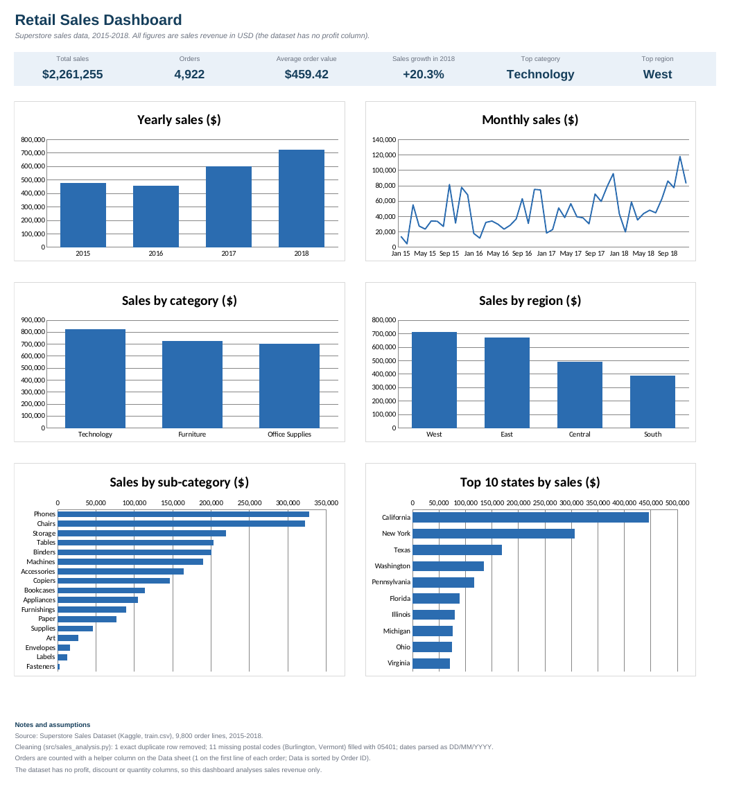
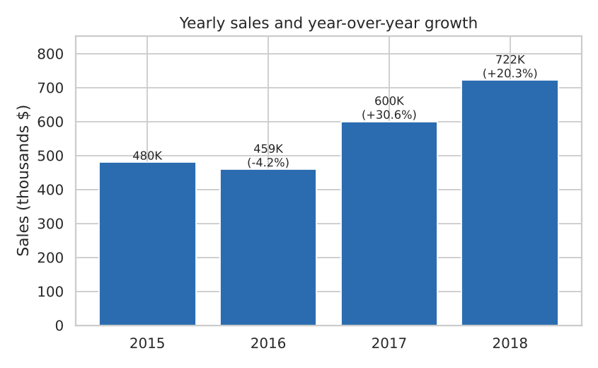
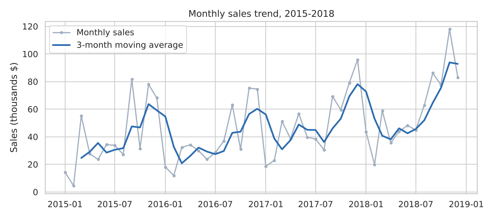
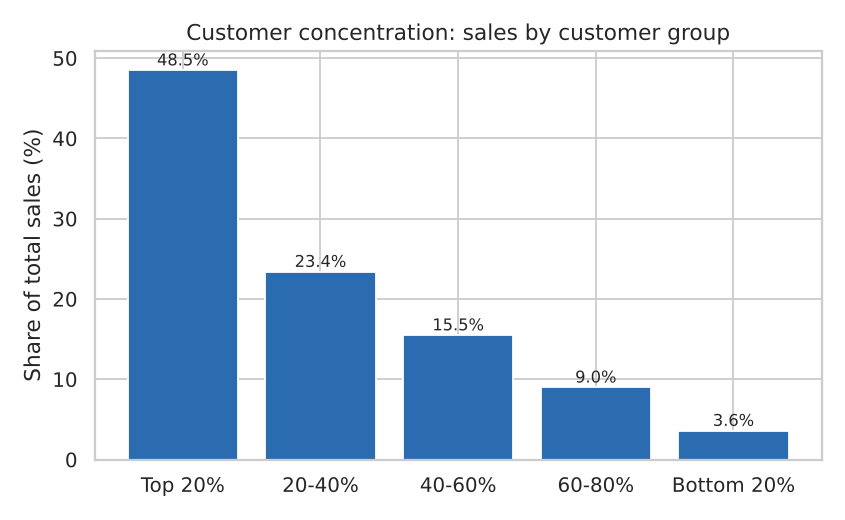

# Retail Sales Analysis & Excel Dashboard

An end-to-end analysis of four years of retail sales: clean the data, explore it with SQL, find what drives revenue, and present it in an Excel dashboard.
Built with **Python (Pandas, Matplotlib), SQL (SQLite) and Excel (formulas + charts)** on the public *Superstore Sales* dataset (Kaggle): 9,800 order lines, 4,922 orders, 793 customers, 1,861 products, January 2015 to December 2018.

> The dataset has **no profit, discount or quantity columns**, so everything here is about sales revenue and customers, not profitability.



## What the project does

1. **Cleans** the data with Pandas: parses DD/MM/YYYY dates, removes 1 exact duplicate row, fills 11 missing postal codes (all Burlington, Vermont).
2. **Explores with SQL**: 10 queries using CTEs, window functions (`LAG`, `RANK`, `NTILE`, moving averages, `SUM() OVER`) and conditional aggregation - see [`sql/sales_queries.sql`](sql/sales_queries.sql) and [`results/sql_results.md`](results/sql_results.md).
3. **Visualises** trends, seasonality, categories, regions and customer concentration with Matplotlib.
4. **Builds an Excel dashboard** ([`excel/Retail_Sales_Dashboard.xlsx`](excel/Retail_Sales_Dashboard.xlsx)): KPI cards, summary tables and six charts. All KPIs and tables are live formulas (`SUMIFS`, `SUMPRODUCT`, `INDEX/MATCH`) over a Data sheet, so they update if the data changes. The formulas were checked against the Pandas results.

## Key findings

**Total sales were $2.26M, with an average order value of $459.**

- **Growth:** sales dipped 4.2% in 2016 ($459K), then grew 30.6% in 2017 ($600K) and 20.3% in 2018 ($722K).
- **Seasonality:** November (15.5%), December (14.2%) and September (13.3%) bring in 43% of all sales; February is the weakest month (2.6%).
- **Categories:** Technology leads with 36.6% of sales, then Furniture (32.2%) and Office Supplies (31.2%). The top sub-categories are Phones ($328K), Chairs ($323K) and Storage ($219K).
- **Products:** one product, the Canon imageCLASS 2200 Advanced Copier, accounts for $61.6K (2.7% of sales) - more than twice the second-best product.
- **Geography:** the West (31.4%) and East (29.6%) generate over 60% of sales; California (19.7%) and New York (13.5%) alone make up a third.
- **Customers:** the top 20% of customers (159 people) generate 48.5% of sales, while the bottom 40% generate only 12.6%.
- **Segments:** Consumers are 50.8% of sales; average order value is similar across segments ($453 to $475).
- **Shipping:** Standard Class handles 59.8% of orders at about 5 days; First Class takes about 2.2 days.





## Project structure

```
data/                put train.csv here (not committed, see below)
sql/                 sales_queries.sql
src/                 sales_analysis.py, build_excel_dashboard.py
excel/               Retail_Sales_Dashboard.xlsx
figures/             charts produced by the analysis
results/             summary.json, sql_results.md
```

## How to run

1. Download the *Superstore Sales Dataset* `train.csv` from Kaggle and save it as `data/train.csv`.
2. Then:

```bash
pip install -r requirements.txt
python src/sales_analysis.py            # cleaning, SQL, charts; writes results/ and figures/
python src/build_excel_dashboard.py     # builds excel/Retail_Sales_Dashboard.xlsx
```

Open the workbook in Excel; the formulas calculate on open.

## Limitations and next steps

- No profit or discount data, so the analysis cannot say which products or regions are actually profitable.
- Summary tables use formulas rather than Excel PivotTables or slicers.
- Descriptive only: no forecasting. A natural next step is a simple time-series forecast of monthly sales.
- US stores only, and monthly sales are volatile (for example, $4.5K in February 2015 vs $55K in March 2015), so month-over-month growth rates should be read with care.
